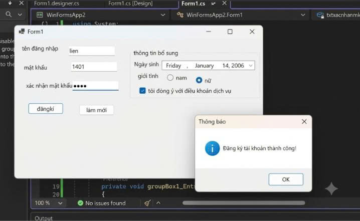
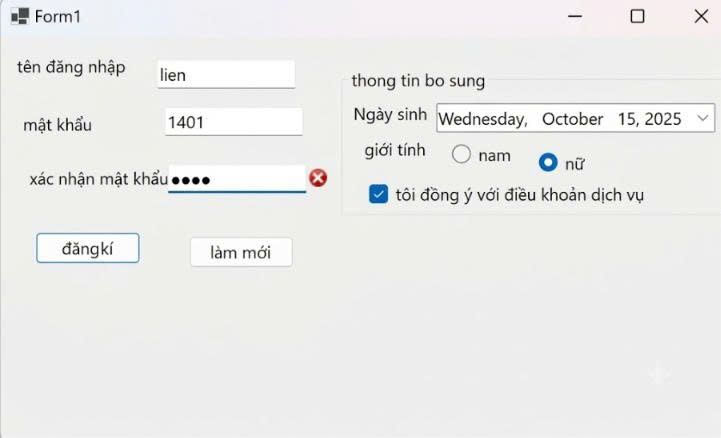
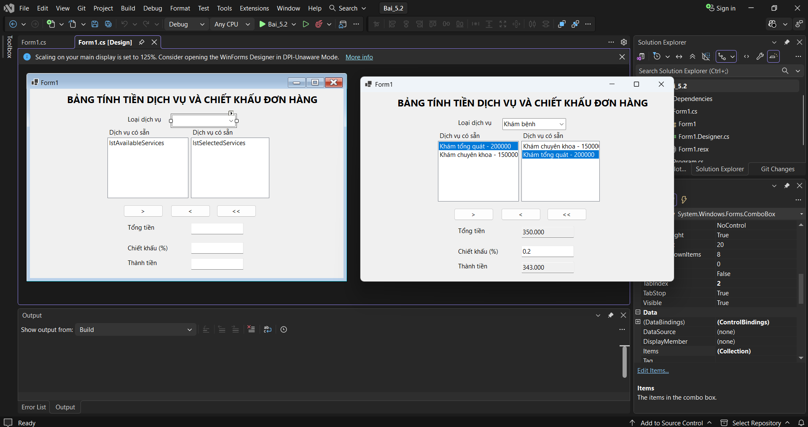
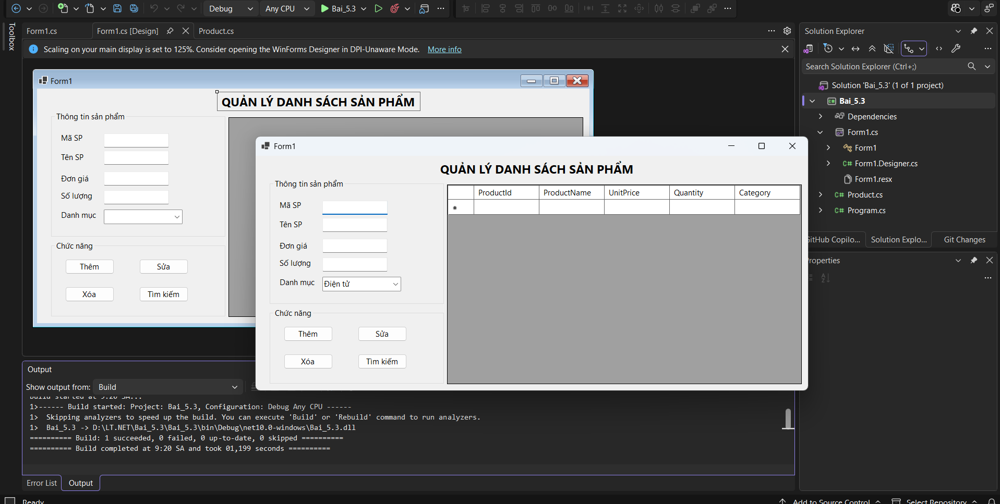
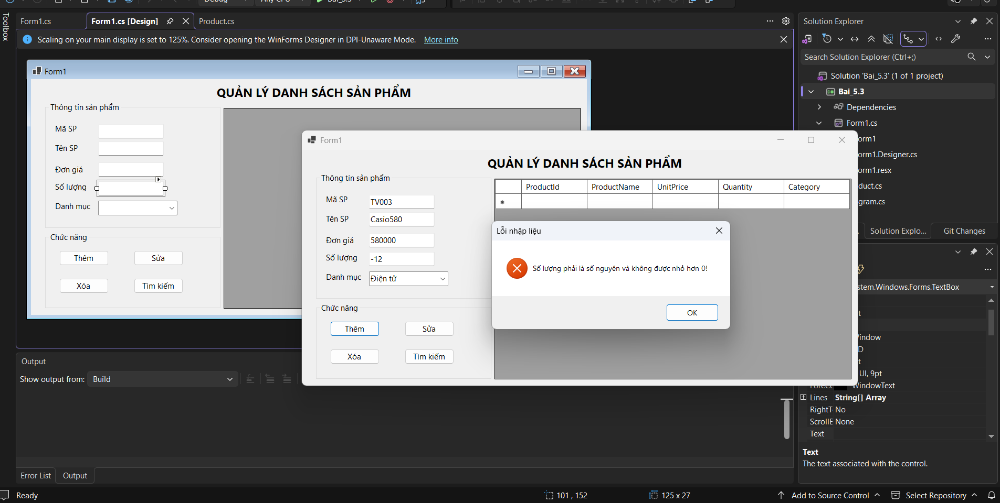
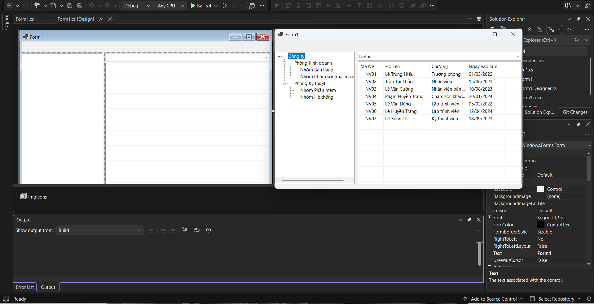

# BÀI TẬP WINDOWS FORMS - 10/10/26

## THÔNG TIN SINH VIÊN
- **Họ và tên:** Trần Thị Kim Liên 
- **Mã số sinh viên:** 24810320108
- **Lớp:** D19QTANM1
- **Tên môn học:** Lập trình C# / Windows Forms
- **Tên bài tập:** Bài tập 5.1 - 5.4

---

## DANH SÁCH BÀI TẬP
| Bài | Tên bài | Thư mục |
|---|---|---|
| 5.1 | Form đăng ký tài khoản và bắt lỗi giao diện (ErrorProvider) | [Bai_5.1](./Bai_5.1) |
| 5.2 | Bảng tính tiền dịch vụ và chiết khấu đơn hàng (ListBox & ComboBox) | [Bai_5.2](./Bai_5.2) |
| 5.3 | Form quản lý danh sách sản phẩm trong bộ nhớ (DataGridView cơ bản) | [Bai_5.3](./Bai_5.3) |
| 5.4 | Trình quản lý tập tin dạng chuyên nghiệp (TreeView & ListView) | [Bai_5.4](./Bai_5.4) |

---

## KẾT QUẢ THỰC HÀNH

### Bài 5.1

### Bài 5.2

### Bài 5.3

### Bài 5.4

---